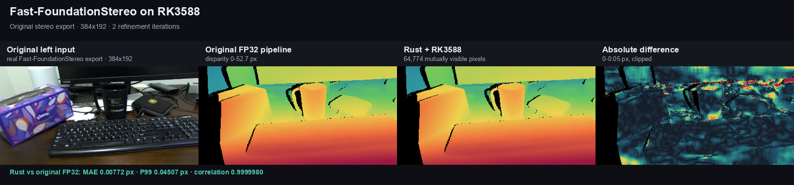

# foundationstereo-rknn

[](https://github.com/jlu-lujing/fast-foundationstereo-rknn-rust/actions/workflows/ci.yml)
[](LICENSE)

High-performance Rust inference for [Fast-FoundationStereo](https://github.com/NVlabs/Fast-FoundationStereo)
on Rockchip RK3588.

The crate runs the complete two-iteration stereo network as one fixed-shape RKNN
graph. It does not require ONNX Runtime, a CPU refinement stage, or intermediate
tensor transfers.

## Performance

Measured on a NanoPC-T6-LTS / RK3588 using all hardware CPU and NPU frequencies:

- CPU `4-7` at 2.256 GHz, CPU `0-3` at 1.8 GHz
- NPU at 1.0 GHz with all three cores enabled (`mask=7`)
- RKNN Runtime 2.5.1, matching the converted model
- Three independent runs, 10 warmups and 50 measured frames per run, no competing NPU workload
- Input `192x384`, `valid_iters=2`, `max_disp=96`, FP16 RKNN

| Scene | Prepared, owned | Prepared, reused | RGB8, owned | RGB8, reused |
|---|---:|---:|---:|---:|
| Real pair 1 | 208.522 ms | 207.745 ms | 206.473 ms | **202.927 ms** |
| Real pair 2 | 207.018 ms | **204.247 ms** | 212.654 ms | 210.234 ms |

The table reports the median of three independent run medians. The model call
dominates runtime; input setup and output collection are below 0.5 ms when inputs
are already packed as FP16 NHWC. The reused-output paths reached **4.928 FPS**
and **4.757 FPS** respectively. Binding work to all eight CPUs was slower and
much less stable than binding to the A76 cluster `4-7`.

The validation board's `rk3588-cpu-cap.service` is disabled. A55 runs at 1.8 GHz
and A76 at 2.256 GHz while these measurements are taken. The CPU limit has not
been re-enabled after testing.

## Comparison with NVIDIA upstream



This uses an input from the NVIDIA project and compares the current RK3588 output
with the original NVIDIA FP32 result. Metrics are evaluated only on pixels
visible in both cameras.

| Comparison with NVIDIA FP32 | Pixels | MAE | P95 | P99 | Correlation |
|---|---:|---:|---:|---:|---:|
| Same `192x384 it2 d96` input | 64,774 | **0.142 px** | **0.414 px** | 0.895 px | **0.99918** |

The original NVIDIA result used the exported FP32 reference from
`192x384_it2_d96/io/disp_fp32_ref.npy`. The RKNN output uses the same input and
fixed model parameters.

The Rust API was also rerun on 32 Blender pairs with rendered disparity truth:

| Blender suite | Scenes | Scored pixels | MAE | P95 | Error > 2 px |
|---|---:|---:|---:|---:|---:|
| Near-object | 16 | 747,333 | **0.179 px** | **0.489 px** | 0.860% |
| Far textured background | 16 | 1,061,605 | **0.160 px** | **0.501 px** | 0.633% |

Full methodology and per-scene results are in
[`docs/validation.md`](docs/validation.md).

## Requirements

- Rockchip RK3588 and a compatible `librknnrt.so`
- RKNN Runtime 2.5.1 for the custom-op stereo graph used in these measurements
- A compatible fixed-shape stereo RKNN model, including the matching custom op
- A C compiler is not required by this crate

The model and NVIDIA weights are not redistributed. See
[`NOTICE`](NOTICE) before deploying or publishing derived artifacts.

## Build

```bash
cargo build --release
cargo test
```

The RKNN runtime is resolved in this order:

1. `RknnOptions::library_path`
2. `RKNN_LIBRARY`
3. `/usr/lib/librknnrt.so`
4. system loader lookup of `librknnrt.so`

## Quick start

Both images must be rectified. The benchmark example resizes them to the model
input dimensions. Pass the matching RKNN runtime when the system library does
not support the model's custom operator.

```bash
cargo run --release --example bench_stereo -- \
  --model /path/to/stereo_192x384_it2_d96.rknn \
  --rknn-lib /path/to/librknnrt.so \
  --core 7 \
  --left left.png \
  --right right.png \
  --warmup 5 \
  --frames 50 \
  --output disparity.f32
```

Inspect the model's declared inputs and outputs with:

```bash
export RKNN_LIBRARY=/path/to/librknnrt.so
cargo run --release --example inspect_model -- /path/to/stereo.rknn
```

Run prepared NHWC FP16 inputs without any image resizing or RGB conversion with:

```bash
cargo run --release --example run_prepared -- \
  --model /path/to/stereo_192x384_it2_d96.rknn \
  --rknn-lib /path/to/librknnrt.so \
  --left left.nhwc.f16 \
  --right right.nhwc.f16 \
  --output disparity.f32
```

## API

```rust,no_run
use foundationstereo_rknn::{FoundationStereo, RknnOptions};

let options = RknnOptions {
    library_path: Some("/path/to/librknnrt.so".into()),
    ..RknnOptions::default()
};
let mut stereo = FoundationStereo::load_with_options("/path/to/stereo.rknn", options)?;
let (width, height) = stereo.input_size();

// `left_rgb8` and `right_rgb8` are contiguous HWC RGB bytes at model size.
let disparity = stereo.infer_rgb8(&left_rgb8, &right_rgb8)?;
assert_eq!(disparity.shape, vec![1, 1, height, width]);

// Reuse one output buffer to avoid per-frame allocation and copying.
let mut reused = vec![0.0; stereo.output_len()];
stereo.infer_rgb8_into(&left_rgb8, &right_rgb8, &mut reused)?;
# Ok::<(), foundationstereo_rknn::Error>(())
```

For zero per-frame packing overhead, keep two `F16Image` buffers and call
`infer(&left, &right)`. `infer_nchw` is available for callers whose camera
pipeline already produces `[1,3,H,W]` float tensors. `infer_into`,
`infer_nchw_into`, and `infer_rgb8_into` accept a caller-owned FP32 output slice
and use RKNN preallocated-output mode.

## Model contract

```text
left:   FP16 NHWC [1,H,W,3], RGB 0..255, pass-through
right:  FP16 NHWC [1,H,W,3], RGB 0..255, pass-through
output: FP32 disparity, one value per input pixel
```

`FoundationStereo` validates that both inputs have the same `[1,H,W,3]` shape,
that the model has exactly two inputs and one output, and that the output has
`H*W` values. The returned tensor is normalized to `[1,1,H,W]`.

## Hardware tuning

Use all three NPU cores (`RknnOptions::default()`) and a performance CPU governor.
On NanoPC-T6-LTS, the full-frequency setup used for the published benchmark is:

```bash
echo performance | sudo tee /sys/devices/system/cpu/cpufreq/policy0/scaling_governor
echo performance | sudo tee /sys/devices/system/cpu/cpufreq/policy4/scaling_governor
echo performance | sudo tee /sys/devices/system/cpu/cpufreq/policy6/scaling_governor
echo 1800000 | sudo tee /sys/devices/system/cpu/cpufreq/policy0/scaling_max_freq
echo 2256000 | sudo tee /sys/devices/system/cpu/cpufreq/policy4/scaling_max_freq
echo 2256000 | sudo tee /sys/devices/system/cpu/cpufreq/policy6/scaling_max_freq
```

If `rk3588-cpu-cap.service` is enabled, disable it too or its 80% limit will be
reapplied at boot. Exact OPPs vary by board and device tree.

See [`docs/architecture.md`](docs/architecture.md) for the execution layout and
[`docs/validation.md`](docs/validation.md) for the accuracy protocol.

## Scope

This release intentionally supports only the fast single-RKNN architecture. The
previous segmented ONNX/CPU pipeline is removed, and there is no fallback path.
Breaking API changes are expected while the crate remains below version 1.0.

## License

The Rust library is MIT licensed. Fast-FoundationStereo and NVIDIA model weights
remain subject to NVIDIA's upstream research/non-commercial terms. No model
weights or `.rknn` artifacts are included in this repository.
